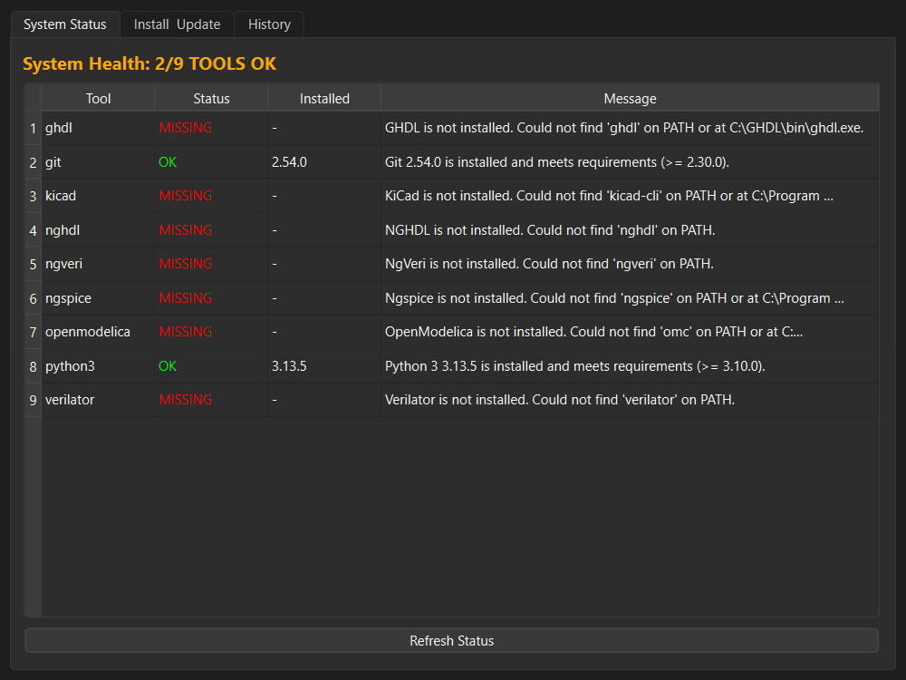
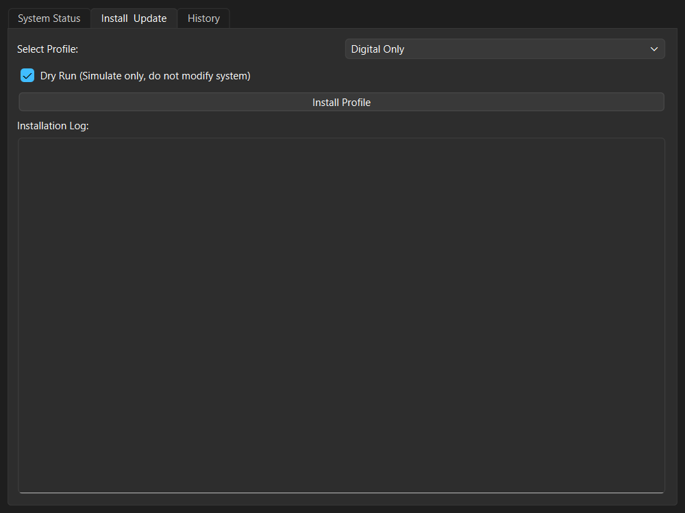
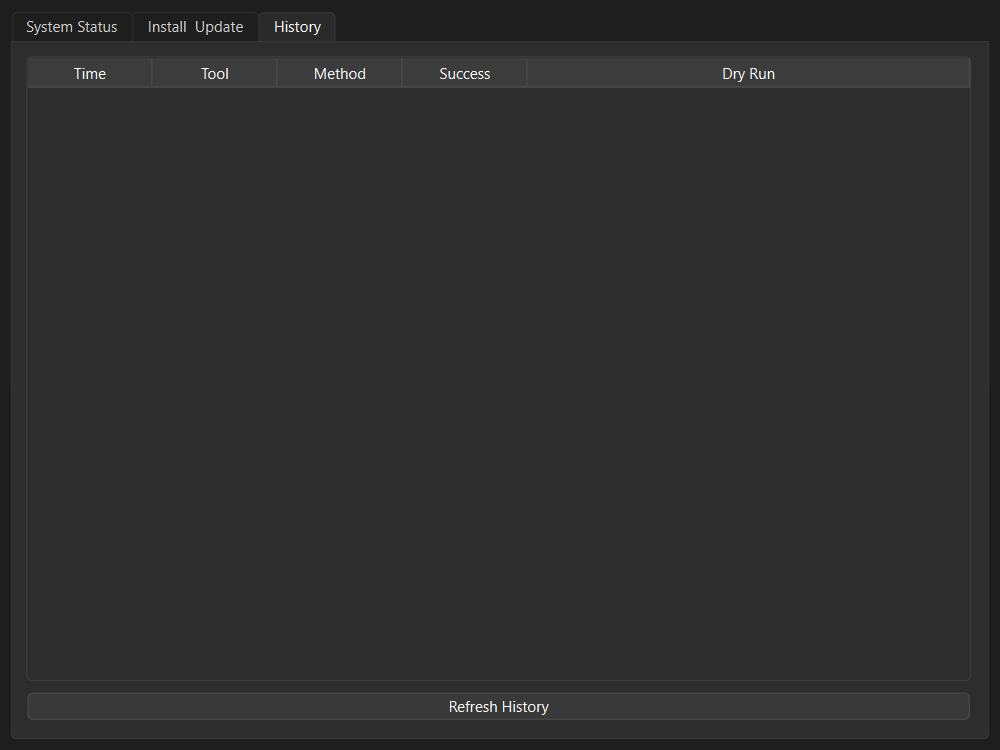

# eSim Automated Tool Manager


A unified installation, configuration, and dependency management utility for the eSim EDA toolchain.

## Context

This project was built for the **FOSSEE eSim Semester Long Internship (Autumn 2026)** as a submission for **Screening Task 5**. It automates the complex setup process of eSim's external open-source toolchain — including Ngspice, KiCad, GHDL, Verilator, and OpenModelica — providing both a robust CLI and a friendly PyQt6 GUI dashboard.

## Feature Implementation Mapping

The core requirements of the screening task map directly to the following modules:

| Requirement | Implementation Module | Status |
|-------------|-----------------------|:------:|
| **Installation Management** | `core.installer`, `infra.package_managers` | ✅ |
| **Update/Upgrade Mechanism** | `core.updater`, `infra.package_managers` | ✅ |
| **Configuration Handling** | `core.config_manager`, `data.seed_registry.yaml` | ✅ |
| **Dependency Checker** | `core.dependency_checker`, `core.dependency_graph` | ✅ |
| **User Interface** | `gui.main_window`, `cli.app` | ✅ |
| **Cross-platform Support** | `infra.os_detect`, modular package managers | ✅ |

## Screenshots

### System Status Dashboard

*Provides a real-time health check of all eSim tools with detailed path and version detection.*

### Profile Installation

*Allows one-click installation of configuration profiles like "Digital Only" or "Full Mixed-Signal", with dry-run support.*

### Audit History

*Tracks a complete history of installation and update attempts using a local SQLite database.*

## Quickstart

The tool can be installed in editable mode for development.

### Requirements
- Python 3.10 or higher
- Git

### Installation
Clone the repository and install with `pip`:

```bash
git clone https://github.com/Trunal2005/eSim-Automated-Tool-Manager.git
cd eSim-Automated-Tool-Manager

# Install with development and GUI dependencies
pip install -e ".[dev,gui]"
```

### Running the Application

**GUI Mode:**
```bash
python -m esim_tool_manager.gui.app
```

**CLI Mode:**
```bash
python -m esim_tool_manager.cli.app --help
```

### Example CLI Output

**Status Check:**
```text
                               eSim Tool Status
┌─────┬──────────────┬─────────┬───────────┬──────────┬───────────────────────┐
│     │ Tool         │ Status  │ Installed │ Required │ Message               │
├─────┼──────────────┼─────────┼───────────┼──────────┼───────────────────────┤
│ ❌  │ ghdl         │ MISSING │ -         │ 4.0.0    │ GHDL is not           │
│     │              │         │           │          │ installed. Could not  │
│     │              │         │           │          │ find 'ghdl' on PA     │
│ ✅  │ git          │ OK      │ 2.54.0    │ 2.30.0   │ Git 2.54.0 is         │
│     │              │         │           │          │ installed and meets   │
│     │              │         │           │          │ requirements (>=      │
│ ❌  │ kicad        │ MISSING │ -         │ 8.0.0    │ KiCad is not          │
│     │              │         │           │          │ installed. Could not  │
│     │              │         │           │          │ find 'kicad-cli'      │
│ ❌  │ nghdl        │ MISSING │ -         │ 0.1.0    │ NGHDL is not          │
│     │              │         │           │          │ installed. Could not  │
│     │              │         │           │          │ find 'nghdl' on       │
│ ❌  │ ngveri       │ MISSING │ -         │ 0.1.0    │ NgVeri is not         │
│     │              │         │           │          │ installed. Could not  │
│     │              │         │           │          │ find 'ngveri' o       │
│ ❌  │ ngspice      │ MISSING │ -         │ 40       │ Ngspice is not        │
│     │              │         │           │          │ installed. Could not  │
│     │              │         │           │          │ find 'ngspice'        │
│ ❌  │ openmodelica │ MISSING │ -         │ 1.20.0   │ OpenModelica is not   │
│     │              │         │           │          │ installed. Could not  │
│     │              │         │           │          │ find 'omc             │
│ ✅  │ python3      │ OK      │ 3.13.5    │ 3.10.0   │ Python 3 3.13.5 is    │
│     │              │         │           │          │ installed and meets   │
│     │              │         │           │          │ requirement           │
│ ❌  │ verilator    │ MISSING │ -         │ 5.0      │ Verilator is not      │
│     │              │         │           │          │ installed. Could not  │
│     │              │         │           │          │ find 'verila          │
└─────┴──────────────┴─────────┴───────────┴──────────┴───────────────────────┘
```

**JSON Output Support (e.g., for CI/CD integration):**
```json
{
  "total_tools": 9,
  "status_counts": {
    "missing": 7,
    "ok": 2
  },
  "results": [
    {
      "tool_id": "python3",
      "status": "ok",
      "installed_version": "3.13.5",
      "required_version": "3.10.0",
      "message": "Python 3 3.13.5 is installed and meets requirements (>= 3.10.0).",
      "executable_path": "C:\\Users\\TRUNAL PATIL\\AppData\\Local\\Programs\\Python\\Python313\\python.EXE"
    }
  ]
}
```

## Architecture

The project strictly follows a **Clean Architecture** model, dividing responsibilities into distinct layers:
1. **Core:** Pure business logic (dependency graph resolution, tool validation, updating).
2. **Data:** Persistence (SQLite schema, YAML tool registry definition).
3. **Infrastructure:** External integration (Package managers: apt/brew/choco, subprocess wrappers).
4. **Presentation:** User interfaces (Typer CLI and PyQt6 GUI).

For detailed design diagrams, please refer to [docs/ARCHITECTURE.md](docs/ARCHITECTURE.md).

## Testing

The project maintains a rigorous automated test suite covering unit tests for Core, Data, Infra, CLI, and GUI components (`pytest-qt`).

- **Test Pass Count:** 125 passed tests
- **Code Coverage:** 72% overall coverage

To run the test suite locally:
```bash
pytest tests/ -v --cov=esim_tool_manager --cov-report=term-missing
```

## Project Structure

```text
eSim-Automated-Tool-Manager/
├── src/
│   └── esim_tool_manager/
│       ├── cli/          # Typer command-line interface
│       ├── core/         # Business logic (Doctor, Checker, Installer)
│       ├── data/         # SQLite persistence & YAML registry
│       ├── gui/          # PyQt6 graphical interface
│       └── infra/        # Package managers & OS abstractions
├── tests/                # 125+ pytest unit and integration tests
├── docs/                 # Architecture Decisions and GUI Screenshots
├── pyproject.toml        # Build configuration and dependencies
└── .github/workflows/    # CI Pipeline for Linting and Testing
```

## Known Limitations

- **Package Manager Support:** While the architecture supports multiple package managers via abstractions, end-to-end package installation is currently only fully tested on Ubuntu/Debian (`apt`). `brew` (macOS) and `choco` (Windows) routing is implemented but untested in production scenarios.
- **REST API / Web Dashboard:** The stretch goal (Phase 9) for a web-based dashboard and REST API was not implemented. The project focused on ensuring maximum robustness for the CLI and PyQt6 Desktop GUI instead.

## License

This project is licensed under the **GNU General Public License v3.0 (GPL-3.0)** — perfectly aligning with eSim's own open-source philosophy.

---
*Built with ❤️ for the FOSSEE eSim Semester Long Internship Screening Task.*
